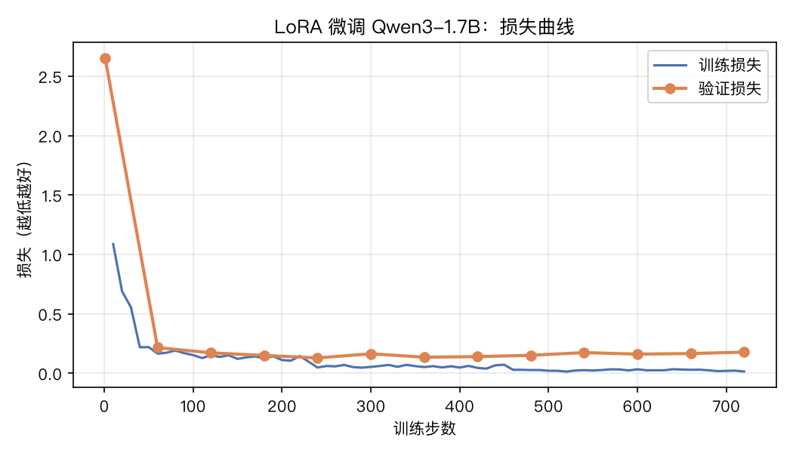
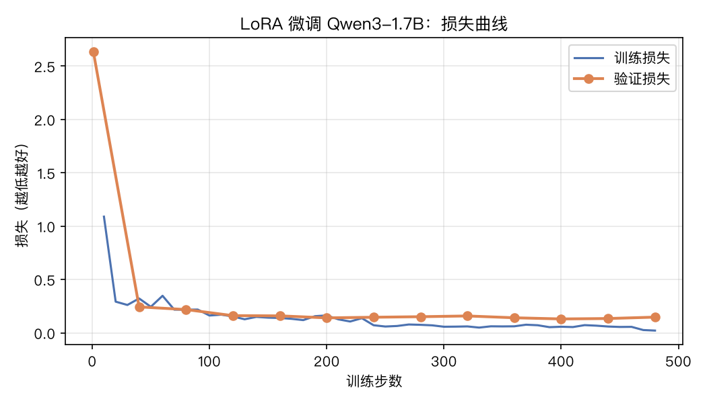

# 评论抽取：用 LoRA 微调小模型

把一条中文电商评论变成程序能直接用的 JSON：

```
输入：声音太小了，老是听不见啊。还有就是待机时间相当的短，大呼上当
输出：{"整体情感":"负面","方面":[{"方面":"使用效果","观点":"声音太小了","情感":"负面"}, ...]}
```

我们在 Mac（Apple M5，32GB）上，用 Apple 的 MLX 框架给 **Qwen3-1.7B** 做 LoRA 微调，
目标是让这个小模型在这个任务上接近一个大 17 倍的模型。

## 整体流程

```
6 万条原始评论 ──抽样──▶ 2425 条 ──老师模型标注──▶ 带答案的数据 ──过滤──▶ 训练集/验证集/测试集
                                                                      │
              原始小模型 ──测分（基线）◀──────────────────────────────┤
                  │                                                   │
                  └──LoRA 微调──▶ 微调后的小模型 ──测分──▶ 对比 ◀─────┘
```

| 步骤 | 脚本 | 在做什么 |
|---|---|---|
| 1 | `scripts/prepare_data.py` | 清洗原始数据，按类别和情感均衡抽样，切成训练/验证/测试三份 |
| 2 | `scripts/label_with_teacher.py` | 让大模型 Qwen3-30B-A3B 当"老师"，给每条评论写出标准答案 |
| 3 | `scripts/build_dataset.py` | 丢掉老师答错的样本，整理成训练格式 |
| 4 | `scripts/evaluate.py` | 微调前先测一次分，作为对比的起点（基线） |
| 5 | `mlx_lm lora -c lora_config.yaml` | LoRA 训练 |
| 6 | `scripts/evaluate.py --adapter adapters` | 微调后再测一次分 |
| 7 | `scripts/plot_loss.py` | 画损失曲线 |
| — | `scripts/annotator_agreement.py` | 换一个模型当第二标注者，衡量标签定义清不清楚 |
| — | `scripts/demo_server.py` | 演示网页 |
| — | `scripts/value_*.py`、`label_server.py` | 进阶：识别低价值评论（见下文） |

公共规则（任务说明、方面列表、易混规则、打分方式）都在 `scripts/common.py`，三个环节共用一套。
项目做了两版标签：第一版的规则、数据、模型、结果都归档在 `runs/v1/`，仓库根目录下是当前的第二版。

## 关键概念

**为什么要微调？** 原始模型"什么都会一点"，但不一定按你的规则来：它会自己编出规则里没有的情感"中性"、
把"火龙果肉小"归到"质量"而不是"口味/尺寸"。微调就是用几千条例子教它"在这件事上按我的规矩做"。

**LoRA 是什么？** 完整微调要改模型的全部 17 亿个参数，很吃内存。LoRA 的做法是：原模型的参数全部冻结不动，
在旁边给每层挂一对很小的矩阵，只训练这对小矩阵。训练完得到的 `adapters/` 只有几十 MB，
用的时候"挂"到原模型上就行。效果通常接近完整微调，成本低得多。

**知识蒸馏（老师 → 学生）** 人工标注 2000 条数据又贵又慢。我们让一个大模型批量标注，再拿它的答案训练小模型。
小模型部署成本低、速度快，这是企业里非常常见的做法。

**为什么要过滤？** 数据集里每条评论本来就有人工标注的"正面/负面"。如果老师判断的整体情感和人工标签对不上，
说明老师这条可能理解错了，用它训练会把学生教坏，所以丢掉。

**`mask_prompt`** 训练时只对"答案"部分算损失。提示词每条都一样，没必要让模型学着复述它。

**训练/验证/测试三份数据** 训练集用来学；验证集在训练过程中检查有没有过拟合；
测试集只在最后打分用一次，模型从来没见过，这样分数才可信。

## 怎么读评估指标

| 指标 | 含义 |
|---|---|
| JSON 合格率 | 输出能不能被程序直接解析使用。线上系统里格式错一条就是一次报错 |
| 整体情感准确率 | 和数据集自带的**人工**标签比，这是唯一一个真·人工标准答案 |
| 方面 F1 | (方面, 情感) 和老师答案逐项比对。F1 同时兼顾"找得全"（召回）和"找得准"（精确） |
| 方面 F1（只看方面名） | 不管情感，只看有没有找对方面 |

## 第一版结果

12 个方面。测试集 264 条，模型训练时从未见过：

| 模型 | JSON 合格率 | 整体情感准确率 | 方面 F1 | 方面 F1（只看方面名） | 秒/条 |
|---|---|---|---|---|---|
| 原始 Qwen3-1.7B | 81.4% | 76.1% | 0.499 | 0.525 | 0.44 |
| **LoRA 第 240 步（采用）** | **99.6%** | **94.3%** | **0.754** | **0.815** | 0.34 |
| LoRA 第 720 步 | 98.1% | 93.6% | 0.763 | 0.819 | 0.37 |



**为什么采用第 240 步而不是训练到最后？** 验证损失在第 240 步（刚好训完 1 轮）最低，之后训练损失继续降、
验证损失却回升，是典型的过拟合。两个检查点在测试集上的方面 F1 只差 0.009，264 条样本下这点差距在误差范围内。
按规矩**用验证集挑模型，测试集只用来报告分数**，否则就等于偷看了考卷。

**微调主要改进了什么？**
- 守规矩：原模型会自造"舒适度""味道""中性"等列表外的值，或者把所有方面都列一遍导致输出被截断；微调后几乎不再出现。
- 归类更准："大小合适"从"外观"改归到"尺寸"，和标注规则一致。
- 速度更快：输出更短、更规整，每条从 0.44 秒降到 0.34 秒。

**还没做好的地方**（第二版就是为了解决这些）
- "耐用"该算质量还是性能、"很舒服"算什么，这类边界情况和老师不一致。根源是方面定义有重叠，需要改标签设计。
- 老师自己也会编造方面名（"位置""口感"），这恰好是定义里出现过的近义词。
- 测试集只保留了老师和人工标签一致的样本，偏"简单"，所以整体情感准确率比真实情况偏高。

第一版模型：`runs/v1/adapters_step240/`（LoRA 权重约 70MB，挂在原模型上使用）。

## 第二版：改进方面标签的定义

### 改了什么

统计第一版里"同一个观点被归到不同方面"和"老师自造列表外方面名"的情况，找到 4 个根源，对应改动：

| 第一版的问题 | 第二版的改法 |
|---|---|
| "质量"装了做工、真假、坏果、死机，和"性能"分不清 | 拆成 做工用料 / 故障瑕疵 / 正品真伪；"性能"改名"使用效果" |
| 老师自造"口感""交通""配件""重量" | 方面名直接用自然说法：口味口感、位置交通、赠品配件、尺寸重量 |
| 赠品算价格吗？配送员算物流还是服务？ | 加 9 条易混规则，如"卡顿 → 使用效果；死机黑屏 → 故障瑕疵" |
| "东西很好"被硬塞进"质量" | 规定完全笼统的评价不抽取 |

另外给老师 4 个标注示例（学生看不到）。规则先试标 48 条，发现"品牌"被归进正品真伪、"排版"被归进包装等 4 个新问题，
改完再试标 96 条确认，才全量标注。

### 新标签是不是更清晰了？

用另一个模型 Qwen3-14B 当**第二标注者**，独立标同一批 285 条测试评论，看它和老师能对上多少（标注者间一致性）：

| | 第一版（12 个方面） | 第二版（16 个方面） | 第二版，不给示例 |
|---|---|---|---|
| 两个标注者一致：方面 F1 | 0.768 | 0.799 | **0.806** |
| 两个标注者一致：只看方面名 | 0.789 | 0.830 | **0.839** |
| 14B 格式不合格 | 6.7% | **2.5%** | 4.6% |
| 老师全量标注格式不合格 | 40 / 2425 | **15 / 2425** | — |

- 一致性提高了约 0.04–0.05，而且第二版的方面从 12 个增加到 16 个。选项越多本来越难对上，所以这个提升是在更难的条件下取得的。
- **提升来自定义本身，不是来自示例**：不给示例时一致性反而略高。示例的作用主要是让标注者**守格式**（14B 的格式错误率从 4.6% 降到 2.5%）。
- 让老师自己带随机性再标一遍，两次的一致度高达 0.96，测不出定义的问题，因为同一个模型的偏好是固定的。所以必须换一个标注者来测。

### 学生模型结果

测试集 262 条：

| 模型 | JSON 合格率 | 整体情感准确率 | 方面 F1 | 方面 F1（只看方面名） | 秒/条 |
|---|---|---|---|---|---|
| 原始 Qwen3-1.7B | 90.8% | 88.2% | 0.513 | 0.540 | 0.52 |
| **LoRA 第 400 步（采用）** | **100%** | **94.7%** | **0.734** | **0.798** | 0.58 |



- 规则写清楚之后，**连没微调的原模型都变好了**：JSON 合格率从 81% 升到 91%，情感准确率从 76% 升到 88%。
- 微调后 JSON 合格率达到 100%。验证损失在第 400 步最低（训了 2 轮），所以采用这个检查点。
- 学生的方面 F1（0.734）和第一版（0.754）差不多，没有明显提高。两者不能直接比：第二版有 16 个方面，标准答案也不一样。
  更有意义的参照是：**1.7B 学生和老师的一致度，已经接近 14B 模型和老师的一致度（0.806）**。
- 速度变慢了：提示词从约 310 token 变成约 780 token，每条从 0.34 秒升到 0.58 秒。
  微调后的模型其实已经学会了规则，下一步可以试着在训练和使用时都去掉长规则、只留一句任务说明，把速度拿回来。

### 还没解决的

统计学生"同一个观点归错方面"的次数，第一版是 41 次，第二版是 40 次，**总量没变，但混淆换了位置**：

- 第一版最常见的"卡/耐用/黑屏在质量和性能之间摇摆"消失了；
- 新出现的是 做工用料 ↔ 使用效果（例如"质量很好"）、故障瑕疵 ↔ 使用效果（例如"键盘有点松"）。

这说明**拆分类别会把边界挪到新的地方**，标签设计需要一轮轮迭代。另外有些"错误"其实是老师标错了
（例如"键盘很漂亮"被老师归进做工用料），只有人工标注一份测试集才能分清是学生错还是老师错。

第二版模型：`adapters_best/`（第 400 步）。

## 进阶：识别低价值评论

刷单模板、"质量好发货快"式的套话、"不错""垃圾"这种没有内容的评论，对商家参考价值不大。
目标是把每条评论分成 5 类：

| 分类 | 例子 |
|---|---|
| 有效评论 | "充电器是坏的，客服推脱" |
| 模板重复 | 很多人、跨类目一字不差的长评论（"我为什么每个商品的评价都一样……"出现了 23 次） |
| 套话好评 | "质量不错，很满意，下次还来" |
| 无信息量 | "不错""好好好""提交成功，还有商品未评价" |
| 空洞差评 | "垃圾""大家不要买"（单独一类：不知道该改什么，但值得联系追问） |

**这次没有现成的标签**，所以由项目作者亲手标了两份标准答案（标注工具：`scripts/label_server.py` + `demo/label.html`）：

- **开发集 150 条**：用来找问题、改规则，可以反复看
- **测试集 100 条**：规则改完、锁定之后才新抽的，只打一次分。打分前核对了代码指纹（`results/value_test_frozen.txt`），证明代码在标注后没改过

两份都是分层抽样（随机 + 疑似重复 + 疑似套话 + 短评论），否则低价值评论太少，没法衡量。

### 三种方法

| 方法 | 做法 |
|---|---|
| A 规则 + 统计 | 至少 4 条互相几乎相同 → 模板；抽取模型一个方面都抽不到 → 空洞差评 / 无信息量；跨类目通用片段占比高的好评 → 套话 |
| B 大模型直接判断 | 把定义、规则和 6 个示例交给老师模型 Qwen3-30B，让它选一类 |
| C 组合 | 用 B 的结果；B 说"没内容"而抽取模型抽到了具体方面时，改判有效评论 |

重复度和套话程度在全部 6.2 万条评论上算（`scripts/value_features.py`，CPU 上 30 秒）。

### 第一轮：两种方法都输给了"什么都不做"

开发集上，在随机抽的评论里，A 和 B 的准确率（80% / 68%）都低于"全部判为有效评论"（83%）。原因：

- **我写的规则和人的实际判断不一致**：规则说"有 1 条重复就算模板"，但只有 2 条一样的多半是同一个人重复提交，人工 28 条里有 22 条标为有效；人工真实的标准是"内容具体就算有效"
- **大模型被情绪带偏**：把"卡！严重卡！垃圾！"这种有具体问题的差评判成空洞差评
- **套话的边界连人都不稳定**：内容几乎一样的两条评论，人工一条标有效、一条标套话

### 第二轮：在开发集上改规则，在测试集上验证

| 测试集（100 条） | 全判有效 | A 规则统计 | B 大模型 | **C 组合** |
|---|---|---|---|---|
| 二分类准确率（值不值得看） | 72% | 79% | 79% | **87%** |
| 低价值：判出来的里面真是低价值的比例 | — | 65% | 57% | **70%** |
| 低价值：真的低价值里找出了多少 | 0% | 54% | 96% | **93%** |
| 五分类准确率 | 72% | 72% | 66% | **75%** |
| 随机抽的 40 条，五分类准确率 | 80% | 82.5% | 77.5% | **85%** |

- **"值不值得看"这个二分类做到了可用**：C 找出了 93% 的低价值评论，判出来的 10 条里有 7 条是对的。
  自助法（bootstrap）估计，在全部 100 条上 C 比"全判有效"高 3～27 个百分点，区间不含 0，这个提升不是运气。
- **细分到 5 类还不可靠**：五分类比对照组高出的区间是 −7～+13 个百分点，含 0，不能说明真的更好。
  测试集里模板重复 6 条、空洞差评 4 条、无信息量 3 条，样本太少，每类的分数波动都很大。
- 开发集上 C 在随机层是 88.3%，测试集是 85%：在没见过的数据上略有下降，但没有崩，说明改规则没有严重过拟合开发集。
- **最弱的是"疑似套话"那一层**：C 的二分类准确率是 80%，而全判有效是 95%。它会把"屏幕大 质量好 用着不错""萍果味好、新鲜"这种带了一点具体细节的好评误判成套话。
  不过同一层里也有"感觉不错，第二次购买了，相信京东"这种被人工标为有效、看起来更像套话的评论，这条边界本身就模糊。

### 学到的

1. **没有标准答案，就不知道方法到底行不行**。我设计规则时觉得很合理，一测才发现比什么都不做还差。
2. **开发集和测试集要分开**：照着答案改规则，分数一定会变好看。只有新抽、没看过的数据上的分数才可信。
3. **能用代码确定的事就交给代码**："至少 4 条相同"交给大模型自己权衡，它会忽略；改成由代码判断后再告诉它，就有效了。
4. **组合不同方法的长处**：大模型擅长理解语气和套话，抽取模型擅长判断"有没有具体内容"，组合起来比单用哪一个都好。

## 演示网页

```bash
uv run python scripts/demo_server.py --version v2   # 浏览器打开 http://localhost:8770；--version v1 看第一版
```

输入一条评论，并排显示原始模型和 LoRA 微调后模型的输出：格式是否合格、不合格的具体原因（比如"方面「舒适度」不在列表里"）、
抽到的方面，以及在原文里高亮出的观点。

后端只加载一份模型：LoRA 层的输出是"原始输出 + scale × 旁路输出"，把 scale 临时设成 0 就变回原始模型，
所以对比两个模型不需要占两份内存。

⚠️ 不要在标注或训练时同时开演示：老师模型约 17GB，加上演示的 3.5GB，GPU 内存会不够，标注会报
`Insufficient Memory` 崩溃（标注脚本支持断点续跑，重新运行即可）。

## 复现

在终端里、项目根目录下逐行运行。需要 Apple Silicon 的 Mac 和 [uv](https://docs.astral.sh/uv/)；
第一次运行会自动从 Hugging Face 下载模型（老师约 17GB，学生约 3.5GB，14B 约 8GB）。

```bash
uv sync
mkdir -p data/raw logs
curl -L -o data/raw/online_shopping.parquet https://huggingface.co/datasets/XiangPan/online_shopping_10_cats_62k/resolve/main/data/train-00000-of-00001.parquet
uv run python scripts/prepare_data.py
uv run python scripts/label_with_teacher.py      # 第二版约 50 分钟；可先加参数 48 只试标 48 条
uv run python scripts/build_dataset.py
uv run python scripts/evaluate.py --name 原始模型
uv run mlx_lm.lora -c lora_config.yaml 2>&1 | tee logs/train.log   # 约 1.5 小时
# 从日志里找验证损失（val）最低的步数，第二版是第 400 步，把它复制成 adapters_best/
mkdir -p adapters_best && cp adapters/adapter_config.json adapters_best/ && cp adapters/0000400_adapters.safetensors adapters_best/adapters.safetensors
uv run python scripts/evaluate.py --name LoRA微调后 --adapter adapters_best
uv run python scripts/annotator_agreement.py --name 对比14B --model mlx-community/Qwen3-14B-4bit --no-examples
uv run python scripts/plot_loss.py
```

低价值评论识别（需要上面的 `adapters_best/`；人工标注已在 `data/value_{dev,test}.jsonl` 里，想自己重标就删掉它们）：

```bash
uv run python scripts/value_features.py                 # 全量重复度和套话程度，约 30 秒
uv run python scripts/label_server.py --split test      # 可选：自己标，浏览器打开 http://localhost:8771
uv run python scripts/value_classify.py --split test    # 三种方法的预测
uv run python scripts/value_eval.py --split test        # 和人工标注比
```

## 局限

- 方面的标准答案来自老师模型，不是人工标注，所以"方面 F1"衡量的是"学生有多接近老师"。
- 数据集只有"正面/负面"两类，没有"中性"，褒贬参半的评论只能二选一。
